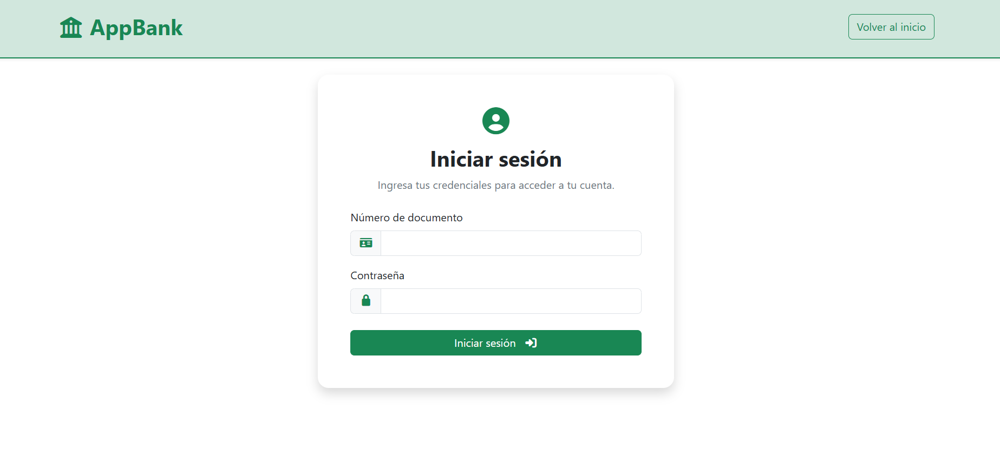
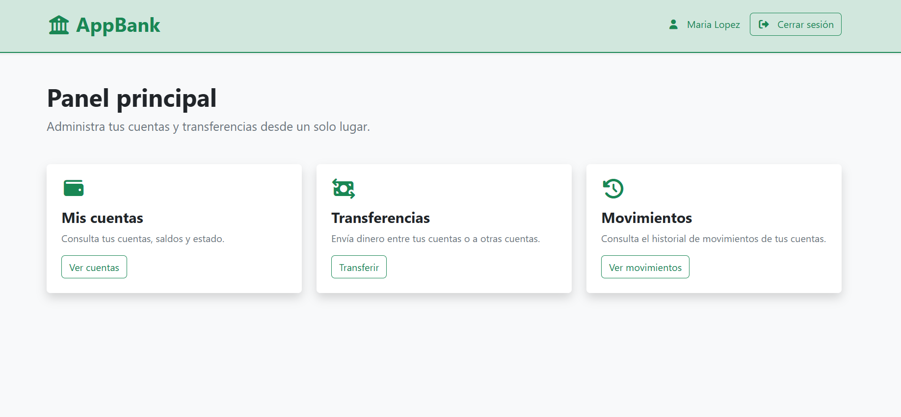
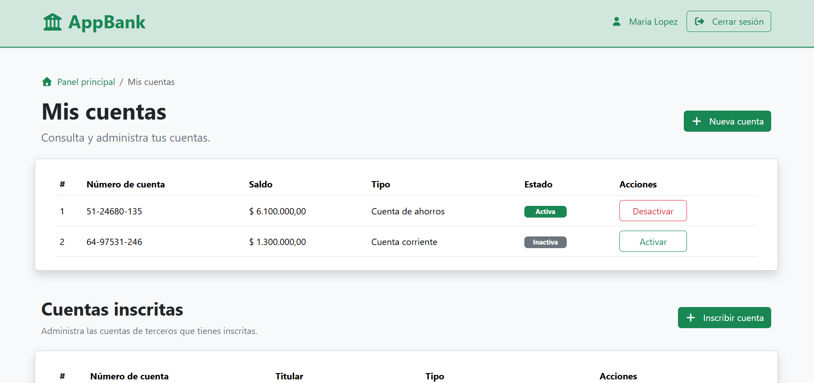
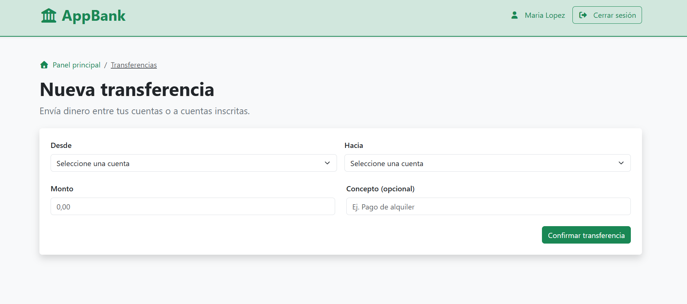
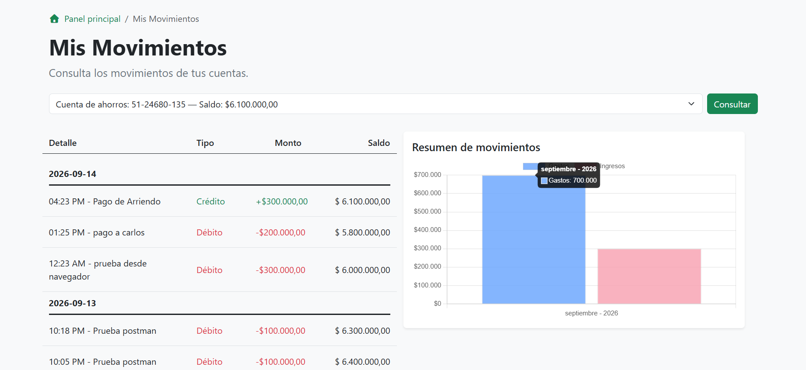

# AppBank


Aplicación de banca digital simulada construida en **PHP nativo** con
arquitectura MVC.

AppBank permite a los clientes autenticarse, administrar múltiples
cuentas, inscribir cuentas de terceros, realizar transferencias y
consultar el historial y resumen mensual de sus movimientos, aplicando
reglas de negocio, controles de seguridad y una arquitectura orientada a
mantener separadas las responsabilidades de la aplicación.

> Proyecto de portafolio enfocado en fundamentos de arquitectura backend con PHP nativo, incluyendo routing, middleware e inyección de dependencias mediante componentes propios.

---

## Contenido

- [Sobre el proyecto](#sobre-el-proyecto)
- [Capturas de pantalla](#capturas-de-pantalla)
- [Funcionalidades](#funcionalidades)
- [Uso de la aplicación](#uso-de-la-aplicación)
- [Credenciales de prueba](#credenciales-de-prueba)
- [Stack](#stack)
- [Arquitectura](#arquitectura)
- [Decisiones técnicas](#decisiones-técnicas)
- [Modelo de datos](#modelo-de-datos)
- [Reglas de negocio](#reglas-de-negocio)
- [Cómo ejecutar el proyecto](#cómo-ejecutar-el-proyecto)
- [Autor](#autor)

---

## Sobre el proyecto

Modela las operaciones básicas de un banco digital:

- Centraliza la gestión básica de productos bancarios de un cliente en
  una sola aplicación.
- Un cliente puede tener varias cuentas.
- Puede activar o desactivar sus cuentas.
- Puede inscribir cuentas de otros clientes como destinatarios.
- Puede realizar transferencias entre cuentas autorizadas.
- Puede consultar los movimientos de sus cuentas.
- Puede visualizar un resumen mensual de débitos y créditos.
- El sistema valida propiedad, estado y reglas de negocio antes de
  operar.

El objetivo del proyecto es demostrar diseño limpio, separación de
responsabilidades, seguridad y control de acceso a recursos 
utilizando **PHP nativo**.

---

## Capturas de pantalla

### Inicio de sesión

AppBank cuenta con autenticación de usuarios y protección de las rutas
privadas mediante sesiones y middleware.

<p align="center">
  
</p>

### Panel principal

El panel principal permite acceder a los módulos de cuentas, transferencias
y movimientos.

<p align="center">
  
</p>

### Gestión de cuentas

Los clientes pueden consultar sus cuentas, visualizar el saldo y estado,
activar o desactivar cuentas y administrar cuentas de terceros inscritas.

<p align="center">
  
</p>

### Transferencias

El módulo de transferencias permite enviar dinero desde una cuenta propia
hacia otra cuenta propia o una cuenta previamente inscrita.

<p align="center">
  
</p>

### Historial y resumen de movimientos

Los movimientos se muestran agrupados por fecha e incluyen tipo, monto y
saldo resultante. El resumen mensual compara débitos y créditos mediante
una gráfica generada con Chart.js.

<p align="center">
  
</p>

---

## Funcionalidades

### Autenticación

- Login con documento y contraseña.
- Passwords hasheados y verificados con `password_verify()`.
- Regeneración de sesión al autenticarse.
- Logout seguro.
- Protección de rutas con middleware.

### Cuentas propias

- Listado de cuentas del cliente.
- Creación de cuentas de ahorro y corriente.
- Generación de número de cuenta único.
- Activación y desactivación con validación de ownership.

### Cuentas inscritas (destinatarios)

- Inscripción de cuentas de terceros.
- Validación por número de cuenta y documento del titular.
- Prevención de:
  - Inscribir una cuenta propia.
  - Inscribir la misma cuenta dos veces.
  - Inscribir una cuenta inexistente.
- Eliminación de inscripción.

### Transferencias

- Transferencias entre cuentas.
- Validación de cuenta origen y cuenta destino.
- Validación del estado de las cuentas.
- Validación de saldo disponible.
- Prevención de transferencias hacia la misma cuenta de origen.
- Registro de la transacción y sus movimientos asociados.
- Operaciones atómicas mediante transacciones de base de datos.
- Registro del saldo resultante después de cada movimiento.

### Movimientos

- Consulta del historial de movimientos por cuenta.
- Movimientos clasificados como débito o crédito.
- Visualización del concepto, monto, hora y saldo posterior.
- Agrupación del historial por fecha.
- Formato monetario para visualización en pesos.
- Resumen mensual de débitos y créditos.
- Consulta asíncrona del resumen mensual mediante Fetch API.
- Endpoint JSON protegido para obtener el resumen de una cuenta.
- Gráfica mensual de movimientos con Chart.js.

### Seguridad

- Protección CSRF en formularios `POST`.
- Middleware dedicado para autenticación y CSRF.
- Validación de ownership sobre recursos del cliente.
- Prepared statements mediante PDO.
- Validaciones de entrada tanto en cliente como en servidor.
- Constraints de integridad en la base de datos.

---

## Uso de la aplicación

Una vez iniciada la aplicación, inicia sesión con cualquiera de las [credenciales de prueba](#credenciales-de-prueba). El panel principal permite acceder a la gestión de cuentas, transferencias y movimientos.

### Caso de uso 1: Administrar cuentas propias

1. Inicia sesión con un cliente de prueba.
2. Accede al módulo de cuentas.
3. Consulta las cuentas asociadas al cliente, su tipo, saldo y estado.
4. Desde este módulo puedes crear una nueva cuenta o activar/desactivar una cuenta existente.

La aplicación valida que el cliente autenticado sea propietario de la cuenta antes de permitir cambios de estado.

### Caso de uso 2: Inscribir un destinatario y realizar una transferencia

1. Inicia sesión con un cliente que tenga una cuenta activa.
2. Accede a la gestión de cuentas inscritas y registra una cuenta perteneciente a otro cliente utilizando su número de cuenta y documento.
3. Accede al módulo de transferencias.
4. Selecciona una cuenta propia activa como origen y la cuenta inscrita como destino.
5. Indica un monto mayor a cero y confirma la operación.

Antes de ejecutar la transferencia, AppBank valida propiedad, estado de las cuentas, saldo disponible y que origen y destino sean diferentes. La operación se ejecuta dentro de una transacción de base de datos y genera los movimientos de débito y crédito correspondientes.

### Caso de uso 3: Consultar movimientos y resumen mensual

1. Accede al módulo de movimientos.
2. Selecciona una de las cuentas del cliente.
3. Consulta el historial agrupado por fecha, incluyendo tipo de movimiento, concepto, monto, hora y saldo resultante.
4. Revisa el resumen mensual de débitos y créditos representado mediante Chart.js.

El resumen mensual se obtiene de forma asíncrona mediante Fetch API desde un endpoint JSON protegido.

---

## Credenciales de prueba

Después de ejecutar `database/seed-demo.php`, la base de datos incluye cuatro clientes de prueba. Todos utilizan la contraseña `Test123`.

| Cliente | Documento | Cuentas | Activas | Inactivas |
| --- | --- | ---: | ---: | ---: |
| Jose Demo | `123456789` | 2 | 2 | 0 |
| Jhon Doe | `987654321` | 2 | 2 | 0 |
| Maria Lopez | `456789123` | 2 | 2 | 0 |
| Carlos Martinez | `741852963` | 2 | 1 | 1 |

En total, los datos de prueba incluyen **8 cuentas: 7 activas y 1 inactiva**.

> Estas credenciales están destinadas exclusivamente al entorno local de desarrollo.

---

## Stack

### Backend

- **PHP 8.x** (Nativo)
- **PDO**
- **Composer**
- **Dotenv**

### Frontend

- **HTML5**
- **CSS3**
- **Bootstrap 5**
- **JavaScript (ES6+)**
- **jQuery**
- **Fetch API (AJAX)**
- **Chart.js**
- SweetAlert2

### Base de datos

- **MySQL 8**

### Infraestructura y herramientas

- **Docker**
- **Docker Compose**
- **Apache**
- **Adminer**

---

## Arquitectura

```text
public/
  index.php                → Front Controller
  js/                      → JavaScript del cliente

app/
  Core/                     → Router, Container (DI) y CSRF
  Middleware/               → AuthMiddleware + CsrfMiddleware
  Controllers/              → Orquestación de casos de uso
  Services/                 → Lógica de negocio
  Models/                   → Acceso a datos
  Enums/                    → Resultados de dominio
  Views/                    → Capa de presentación
  helpers.php               → Funciones auxiliares

routes/
  web.php                   → Definición de rutas

config/
  database.php              → Configuración de base de datos

database/
  schema.sql                → Estructura de la base de datos
  seed-demo.php             → Generador de datos de demostración
```

La aplicación utiliza un **Front Controller** como único punto de
entrada. El Router resuelve las rutas y ejecuta los middleware
correspondientes antes de delegar la petición al controlador.

El contenedor de dependencias utiliza **Reflection** para resolver
automáticamente dependencias estructurales entre controllers, services,
models y PDO.

---

## Decisiones técnicas

- **Router propio** con soporte para vistas, controllers y middleware.
- **Contenedor de dependencias** con resolución mediante Reflection.
- **Middleware de autenticación** para rutas protegidas.
- **Middleware CSRF** para proteger operaciones `POST`.
- **Constructor Dependency Injection** para controllers y services.
- **Service Layer** para encapsular la lógica de las transferencias.
- **Ownership checks** en operaciones sobre cuentas.
- **PDO Prepared Statements** para acceso seguro a la base de datos.
- **Transacciones de base de datos** para garantizar atomicidad
  durante transferencias.
- **DECIMAL** para almacenar valores monetarios, evitando cálculos
  financieros con `float`.
- **Fetch API** para consumir de forma asíncrona el resumen mensual de
  movimientos.
- **Chart.js** para representar visualmente débitos y créditos.
- **Constraints** en base de datos (`CHECK`, `UNIQUE`, `FOREIGN KEY`)
  para reforzar reglas de integridad.

---

## Modelo de datos

Tablas

| Tabla               | Descripción                                                                  |
| ------------------- | ---------------------------------------------------------------------------- |
| customers           | Clientes del banco                                                           |
| accounts            | Cuentas bancarias                                                            |
| registered_accounts | Cuentas de terceros inscritas por un cliente                                 |
| transactions        | Operaciones de transferencia entre una cuenta de origen y una cuenta destino |
| movements           | Efecto débito o crédito producido por una transacción sobre una cuenta       |

Una transferencia genera una entrada en `transactions` y dos movimientos
asociados:

- **DEBIT** para la cuenta origen.
- **CREDIT** para la cuenta destino.

Cada movimiento almacena el saldo de la cuenta después de aplicar la
operación (`balance_after`).

---

## Reglas de negocio

- Un cliente puede tener múltiples cuentas.
- Una cuenta pertenece a un único cliente.
- Una cuenta de terceros debe existir antes de poder ser inscrita.
- Un cliente no puede inscribir una cuenta propia como cuenta de
  terceros.
- Una misma cuenta de terceros no puede inscribirse más de una vez.
- El saldo de una cuenta no puede ser negativo.
- Solo el propietario de una cuenta puede modificar su estado.
- Una transferencia no puede tener la misma cuenta como origen y
  destino.
- El monto de una transferencia debe ser mayor a 0.
- Las cuentas involucradas en una transferencia deben estar activas.
- Una transferencia debe ejecutarse completamente o revertirse.
- Cada transacción genera los movimientos correspondientes de débito y
  crédito.

---

## Cómo ejecutar el proyecto

Puedes ejecutar AppBank con Docker o con PHP y MySQL instalados localmente.

### Opción 1: Docker

**Requisitos:** Git, Docker y Docker Compose.

1. Clona el repositorio:

```bash
git clone https://github.com/josecarlosonate/AppBank.git
cd AppBank
```

2. Crea el archivo `.env`:

```bash
cp .env.example .env
```

3. Configura las variables de conexión en `.env`:

```dotenv
DB_HOST=db
DB_PORT=3306
DB_DATABASE=appbank_db
DB_USERNAME=appbank_user
DB_PASSWORD=tu_password
MYSQL_ROOT_PASSWORD=tu_password_root
```

4. Construye la aplicación e inicia MySQL:

```bash
docker compose build app
docker compose up -d db
```

5. Cuando MySQL esté listo, carga los datos de demostración:

```bash
docker compose run --rm --no-deps app php database/seed-demo.php
```

6. Inicia AppBank y Adminer:

```bash
docker compose up -d app adminer
```

**Aplicación:** http://localhost:8080  
**Adminer:** http://localhost:8081

Para detener los contenedores:

```bash
docker compose down
```

### Opción 2: PHP y MySQL locales

**Requisitos:** Git, PHP 8.3 o superior (64 bits) con `pdo_mysql`, Composer y MySQL 8.4.

1. Clona el repositorio e instala las dependencias:

```bash
git clone https://github.com/josecarlosonate/AppBank.git
cd AppBank
composer install
cp .env.example .env
```

2. Accede a MySQL desde la terminal con el usuario administrador `root`:

```bash
mysql -u root -p
```

Introduce la contraseña de `root` que configuraste al instalar MySQL.

3. Crea la base de datos y el usuario que utilizará AppBank. En `IDENTIFIED BY 'tu_password'`, sustituye `tu_password` por la contraseña que quieras asignar a `appbank_user`. Esa misma contraseña debe ir en `DB_PASSWORD` dentro de `.env`.

Ejecuta estas instrucciones en MySQL:

```sql
CREATE DATABASE appbank_db
  CHARACTER SET utf8mb4
  COLLATE utf8mb4_0900_ai_ci;

CREATE USER 'appbank_user'@'localhost'
  IDENTIFIED BY 'tu_password';

GRANT SELECT, INSERT, UPDATE, DELETE
  ON appbank_db.* TO 'appbank_user'@'localhost';

EXIT;
```

4. Configura `.env`:

```dotenv
DB_HOST=localhost
DB_PORT=3306
DB_DATABASE=appbank_db
DB_USERNAME=appbank_user
DB_PASSWORD=tu_password
```

5. Desde la terminal, importa la estructura de la base de datos:

```bash
mysql -u root -p appbank_db < database/schema.sql
```

6. Genera los datos de demostración:

```bash
php database/seed-demo.php
```

7. Inicia la aplicación:

```bash
php -S localhost:8000 -t public
```

Abre **http://localhost:8000** y utiliza las [credenciales de prueba](#credenciales-de-prueba) para iniciar sesión.

### Datos de demostración

`seed-demo.php` crea 4 clientes, 8 cuentas bancarias, 84 transferencias y 168 movimientos distribuidos durante seis meses. El saldo total inicial es de **31.450.000 COP**.

---

## Autor

**Jose Carlos Oñate Rodríguez**

Proyecto de portafolio --- PHP nativo / MySQL / Arquitectura MVC
